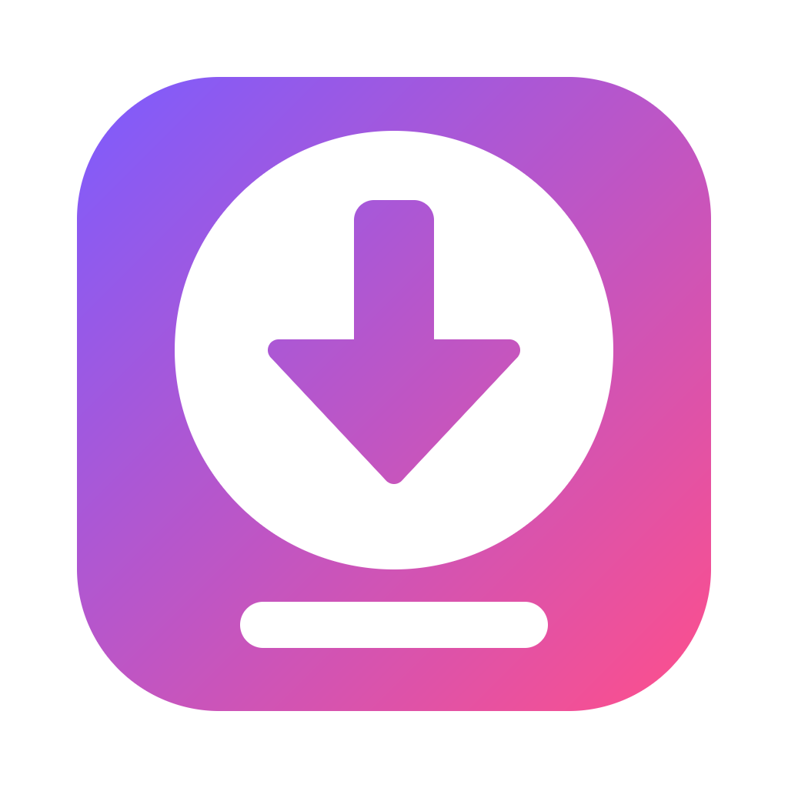

# Scrapitube



Appli de bureau (Mac) pour télécharger des vidéos ou playlists YouTube, en
vidéo (MP4 / MKV / WebM, jusqu'à la 4K) ou en audio seul (MP3). Écrite en Rust
(interface `egui`), elle pilote [yt-dlp](https://github.com/yt-dlp/yt-dlp) pour
le téléchargement proprement dit.

## Télécharger

**[⬇ Télécharger la dernière version (.dmg)](https://github.com/Vorbisset/scrapitube/releases/latest)**

Ouvre le `.dmg`, glisse Scrapitube dans Applications, puis suis le `Lisez-moi.txt`
pour la première ouverture (l'appli n'est pas notarisée par Apple : macOS demande
de l'autoriser une fois dans Réglages Système → Confidentialité et sécurité).
Fonctionne sur Mac Apple Silicon et Intel (macOS 11+), sans rien installer d'autre.

## Compiler soi-même

### Prérequis

```bash
brew install yt-dlp ffmpeg
curl --proto '=https' --tlsv1.2 -sSf https://sh.rustup.rs | sh   # Rust
```

### Appli de bureau

```bash
./make_app.sh             # crée « Scrapitube.app » dans ce dossier
./make_app.sh --install   # ... et la copie aussi dans ~/Applications
```

Ensuite, lance-la depuis le Finder, Launchpad ou Spotlight (ou directement :
`cargo run --release`). L'appli est autonome (le binaire est copié dans le
`.app`). Ses logs sont dans `~/Library/Logs/scrapitube.log`.

## Partager l'appli (installateur .dmg)

```bash
./make_dmg.sh             # crée dist/Scrapitube-<version>.dmg
```

L'installateur fonctionne sur n'importe quel Mac récent (Apple Silicon et Intel,
macOS 11+) **sans rien installer d'autre** : yt-dlp (version officielle) et
ffmpeg (version autonome de [martin-riedl.de](https://ffmpeg.martin-riedl.de))
sont embarqués. Ils sont téléchargés une fois dans `vendor/` avec vérification
SHA-256 ; supprime ce dossier pour en reprendre des versions récentes.

Au premier lancement, l'appli copie ces outils dans
`~/Library/Application Support/Scrapitube/bin`, où yt-dlp peut se mettre à jour
(bouton « Mettre à jour yt-dlp » en bas de la fenêtre).

### Sans compte Apple Developer

L'appli est signée « ad hoc » : à la première ouverture, macOS la bloque. Le
`Lisez-moi.txt` du .dmg explique comment l'autoriser (Réglages Système →
Confidentialité et sécurité → « Ouvrir quand même »).

### Avec un compte Apple Developer (signature + notarisation)

Une appli signée « Developer ID » puis **notarisée** par Apple s'installe sans
aucun avertissement. Mise en place, une seule fois :

1. Adhère à l'[Apple Developer Program](https://developer.apple.com/programs/)
   (99 €/an).
2. Crée un certificat **Developer ID Application** : Xcode → Réglages → Comptes →
   Gérer les certificats → « + », ou sur developer.apple.com. Vérifie qu'il est
   dans le trousseau : `security find-identity -v -p codesigning`.
3. Crée un mot de passe pour app sur [account.apple.com](https://account.apple.com)
   (Connexion et sécurité), puis enregistre-le pour la notarisation :

   ```bash
   xcrun notarytool store-credentials scrapitube \
     --apple-id ton@email.com --team-id ABCDE12345 --password xxxx-xxxx-xxxx-xxxx
   ```

Ensuite, à chaque version :

```bash
SIGN_IDENTITY="Developer ID Application: Prénom Nom (ABCDE12345)" \
NOTARY_PROFILE="scrapitube" ./make_dmg.sh
```

Le script signe yt-dlp, ffmpeg puis l'appli (hardened runtime ; yt-dlp reçoit
les droits de [entitlements/yt-dlp.plist](entitlements/yt-dlp.plist) car c'est
un programme Python empaqueté), signe le .dmg, l'envoie à Apple, attend la
validation (quelques minutes) et y joint le ticket de notarisation.

## Utilisation

- Colle un lien (ou clique sur **📋 Coller**) : l'appli l'analyse aussitôt et
  affiche la miniature, le titre, la chaîne, la durée et les qualités
  réellement disponibles pour cette vidéo.
- Choisis **Vidéo / Audio MP3**, la qualité, le format et les sous-titres, puis
  clique sur le gros bouton **Télécharger**. Deux téléchargements tournent en
  parallèle, les autres attendent.
- **Extrait** : coche « Télécharger seulement un extrait » et règle le début et
  la fin (curseurs, ou saisie : `90`, `1:30` ou `1:02:03`). Le fichier porte les
  bornes dans son nom, par ex. `Titre [id] (extrait 1m30-2m45).mp4`. La coupe est
  précise à l'image près (les bords sont ré-encodés, c'est un peu plus long).
- **Playlist** : pour un lien qui contient `list=`, coche « Télécharger toute la
  playlist » pour tout récupérer (sinon seule la vidéo est téléchargée).
- Dossier par défaut : `~/Movies/YouTube`. Les réglages sont mémorisés.

## Dépannage

- **« yt-dlp introuvable »** : `brew install yt-dlp`, puis « Réessayer » en bas
  de la fenêtre.
- **Un lien qui marchait ne marche plus** : YouTube change souvent ses
  protections, mets yt-dlp à jour : `brew upgrade yt-dlp`.

Pour un usage personnel : respecte les droits d'auteur et les conditions
d'utilisation de YouTube.

Logiciels tiers embarqués dans le .dmg (yt-dlp, FFmpeg) : voir
[THIRD-PARTY-NOTICES.md](THIRD-PARTY-NOTICES.md).
